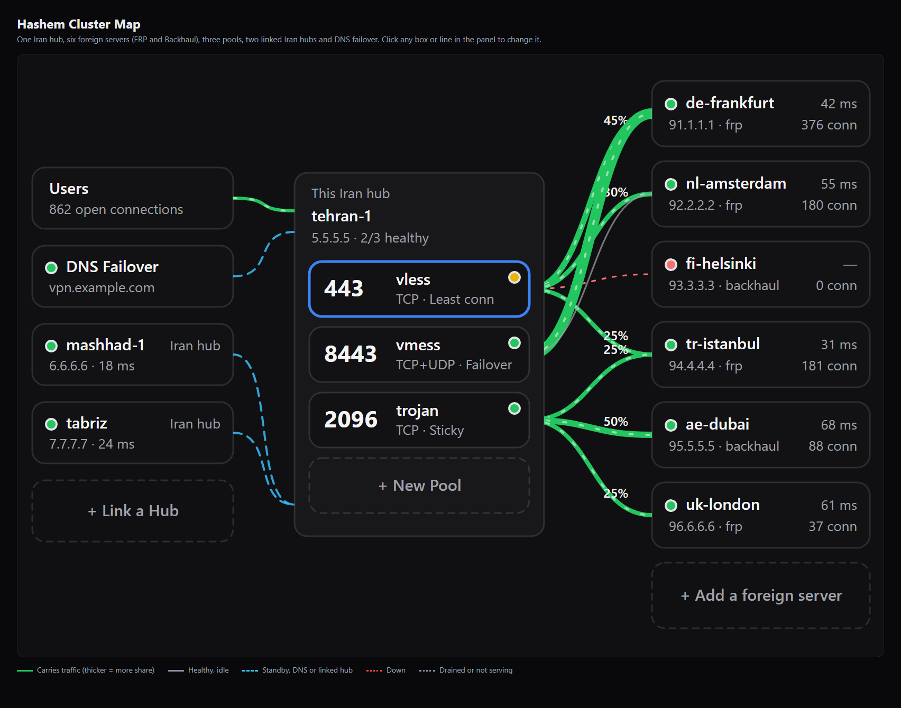

<div align="center" dir="rtl">

# پنل هاشم 🇮🇷 ↔ 🌍

**مدیریت تانل «هاب و اسپوک»: لینک GRE لایه ۳ به‌همراه رله‌ی معکوس FRP / Backhaul، با داشبورد وب، مدل سلامت، واچ‌داگ و آپدیت امن.**

*سرورهای اصلی پنهان می‌مانند؛ پورت‌های سرور خارج از طریق IP عمومی سرور ایران در دسترس قرار می‌گیرند.*

[🇬🇧 English](README.md) | 🇮🇷 فارسی

[](https://github.com/firegoood/haship/releases/latest)
[](https://github.com/firegoood/haship/actions/workflows/ci.yml)
[](https://www.gnu.org/licenses/agpl-3.0)

[🌐 وب‌سایت](https://pdnczone.ir) · [✈️ تلگرام](https://t.me/pdnczone) · [▶️ یوتیوب](https://youtube.com/@pdnczone) · *DNC MADE THIS*

</div>

<div dir="rtl">

---

## هاشم چیست؟

هاشم یک مدیر تانل است که از دو بخش ساخته شده:

- **نصاب / CLI** — فایل `hashem.sh` (با نام `hashem` نصب می‌شود). سرویس‌های GRE، FRP و Backhaul را با systemd راه‌اندازی می‌کند.
- **پنل** — یک برنامه‌ی Go با رابط وب تک‌صفحه‌ای (`gre-panel`). روی هر دو سرور اجرا می‌شود و تانل، پیرها، سلامت، تأخیر، لاگ، عیب‌یابی و آپدیت را نشان می‌دهد.

مدل کار **هاب و اسپوک** است:

- **هاب ایران** سروری در ایران است. `frps` یا سرور Backhaul و پنل روی آن اجرا می‌شود و پورت‌های عمومی که کاربران به آن وصل می‌شوند مال همین سرور است.
- هر **سرور خارج** یک اسپوک است. `frpc` یا کلاینت Backhaul را اجرا می‌کند و به هاب وصل می‌شود. ترافیکی که به هاب برسد به سرور خارج رله می‌شود.
- چند سرور خارج می‌توانند به یک هاب وصل شوند. سقف پیش‌فرض ۱۰ پیر است و با متغیر محیطی `GRE_MAX_PEERS` تغییر می‌کند.

---

## چرا هاشم؟

`frp` یا Backhaul خام فقط یک رله و یک فایل تنظیمات به شما می‌دهند. هاشم بخش‌هایی را اضافه می‌کند که وگرنه باید دستی بسازید:

- **لینک لایه ۳ زیر رله** (GRE مستقیم یا روی WSS). اگر GRE بسته شود، رله می‌تواند با IP عمومی هاب وصل شود.
- **بسته‌ی راه‌اندازی (bundle)** — یک رشته که کل تنظیمات سمت خارج را می‌سازد؛ بدون کپی دستی توکن، پورت و IP.
- **یک مدل سلامت واحد** — بنر داشبورد، کارت‌ها و نقشه‌ی توپولوژی از یک قانون استفاده می‌کنند و می‌گویند کدام بخش قطع است.
- **عملیات داخلی** — واچ‌داگ، هشدار وبهوک/تلگرام فقط هنگام تغییر وضعیت، تاریخچه‌ی ۲۴ ساعته، بکاپ رمزنگاری‌شده، `hashem doctor`.
- **آپدیت قابل برگشت** — کانال stable/dev، تأیید SHA-256، بکاپ تنظیمات پیش از هر جایگزینی و بازگشت خودکار.
- **پنل مقاوم‌سازی‌شده** — رمز argon2id، CSRF، ۲FA اختیاری، لاگ ممیزی، ترمینال به‌صورت پیش‌فرض خاموش.
- **کلاستر** [PRO] — یک پورت ایران روی چند سرور خارج (Failover، تقسیم بار، ثابت برای هر کاربر، کمترین تأخیر، کمترین اتصال، سرور آماده، سقف اتصال، بررسی سرویس از داخل تونل)، چند سرور ایران روی یک خارج، پشتیبانی هاب‌های ایران از هم و جابه‌جایی DNS، روی یک نقشه‌ی زنده که هر بخشش با کلیک قابل تغییر است. [نحوه‌ی کار و آموزش](docs/CLUSTER_TUTORIAL.fa.md) · [راهنمای کامل](docs/CLUSTER.fa.md).

اگر فقط یک رله روی یک جفت سرور می‌خواهید و ویرایش TOML برایتان مشکلی نیست، frp یا Backhaul خام ساده‌تر است. هاشم برای چند لینک است که باید زیر نظر باشند و زنده بمانند.

---

## تازه‌های نسخه‌ی 2.6.0

- 🎭 **تونل اسپوف (جدید، Pro).** برای فایروال‌های لایه ۳ که با لیست سفید کار می‌کنند (همان چیزی که در قطعی‌های اینترنت ایران دیده شد): هر دو سرور IP مبدأ را جعل می‌کنند و IP واقعی طرف مقابل را می‌دانند. بر پایه‌ی [ParsaKSH/spoof-tunnel](https://github.com/ParsaKSH/spoof-tunnel). پنل روی این پایپ خام WireGuard می‌گذارد تا یک تونل رمزگذاری‌شده‌ی واقعی بسازد، کلیدهای هر دو طرف را خودش می‌سازد و یک باندل به سرور خارج می‌دهد. تب **Spoof** مخصوص خودش را دارد، با **تستر IP اسپوف** که پیدا می‌کند کدام IPهای مبدأ از فایروال رد می‌شوند.
- 🔀 **عوض کردن حامل هر تونل.** تونل اصلی یا هر سرور خارج را از روی کارتش بین GRE + FRP، Backhaul روی GRE و Backhaul بدون GRE جابه‌جا کنید. هر دو سرور عوض می‌شوند و اگر حامل جدید تا ۴۵ ثانیه وصل نشود، روی هر دو برمی‌گردد.
- 📡 **UDP در همه‌ی تونل‌ها.** با یک تیک (Also forward UDP)، Backhaul روی هر ترنسپورتی UDP را هم منتقل می‌کند، حتی tcpmux و wss (یک تونل همراهِ UDP روی اولین پورت آزاد بعدی که با خود تونل مدیریت می‌شود)، و باقر هم UDP را از داخل تونل SSH رد می‌کند. FRP از قبل این کار را می‌کرد. برای Hysteria، TUIC، WireGuard، QUIC و بازی‌ها.
- 🗺️ **نقشه‌ی همه‌ی تونل‌ها** در داشبورد و نمودار لینک روی کارت هر تونل، با سرعت زنده‌ی دو طرف. نمودار ترافیک حالا Backhaul و باقر را هم می‌شمارد.

فهرست کامل: [CHANGELOG](CHANGELOG.md).

## تازه‌های نسخه‌ی 2.5.0

- 🕸️ **کلاستر: دیگر هیچ نقطه‌ی شکستِ تکی نیست.** یک پورت ایران روی چند سرور خارج (Failover، تقسیم بار، ثابت برای هر کاربر، کمترین تأخیر، کمترین اتصال). بررسی سلامت هر ثانیه، و **بررسی سرویس از داخل تونل** که xrayِ مرده پشت تونلِ سالم را هم می‌گیرد. سرور آماده، سقف اتصال، تخلیه برای تعمیرات و برگشت دستی. چند سرور ایران می‌توانند از همان سرورهای خارج استفاده کنند، هاب‌های ایران پشتیبان هم‌اند، و جابه‌جایی DNS (Cloudflare یا هر سرویس‌دهنده با وب‌هوک) دامنه را روی هاب‌های سالم نگه می‌دارد. همه‌چیز در کرنل اجرا می‌شود: سرعت کم نمی‌شود، IP واقعی کاربر حفظ می‌شود و ری‌استارت پنل هیچ اتصالی را قطع نمی‌کند.
- 🗺️ **نقشه‌ی کلاستر.** تصویر زنده‌ی کل کلاستر. ضخامت خط سهم ترافیک هر سرور و رنگ آن سلامتش است. روی هر سرور، استخر، خط، هاب یا DNS کلیک کنید تا همان‌جا تغییرش دهید.
- 🧪 **تست مسیر پیش از ساخت تونل.** در تب Benchmark همه‌ی ترنسپورت‌ها (TCP/UDP، GRE، SSH، پنج حالت FRP و هفت حالت Backhaul) را بین دو سرور با تأخیر و سرعت تست کنید و بدانید چه چیزی رد می‌شود.
- 🧩 **همه‌ی تونل‌ها در راه‌اندازی.** GRE + FRP، Backhaul (با یا بدون GRE، حالا یک موتور) و باقر، همه از تب‌های راه‌اندازی و تونل. تونل‌های قدیمی «Modified Backhaul» خودشان منتقل می‌شوند.
- 🔁 **برگشت خودکار به GRE.** سرور خارجی که به IP عمومی هاب رفته بود، وقتی GRE دوباره کار کند خودش به GRE برمی‌گردد.
- 💻 **`hashem` یک برنامه‌ی ترمینالی شده** با منوهای کلیدهای جهت‌نما که مثل تب‌های پنل است. هر کاری پنل می‌کند از SSH هم انجام می‌شود (TLS، تنظیمات، کلاستر، کارایی).
- ⚙️ **تنظیمات FRP همان‌جایی که اثر دارند:** PROXY protocol (v1/v2)، محدودیت پهنای باند برای هر پورت، health check، TCP multiplexing؛ و connection pool برای Backhaul. Let's Encrypt در تنظیمات درست شد.
- 🔐 **Hashem Pro** حالا کلاستر، تست مسیر، راه‌اندازی Backhaul، عیب‌یابی، کارایی، واچ‌داگ و بنچمارک را پوشش می‌دهد. هر لایسنس Pro فعلی همه را باز می‌کند و تونل‌هایی که کار می‌کنند هیچ‌وقت قطع نمی‌شوند.



فهرست کامل: [CHANGELOG](CHANGELOG.md). کلاستر: [نحوه‌ی کار و آموزش](docs/CLUSTER_TUTORIAL.fa.md) · [راهنمای کامل](docs/CLUSTER.fa.md).

---

## نیازمندی‌ها

- **سیستم‌عامل:** لینوکس با **systemd**، معماری `amd64` یا `arm64`. روی Ubuntu توسعه و آزمایش شده. نصاب بسته‌های کم‌شده را با `apt-get` (و در صورت نبود، `yum`) نصب می‌کند.
- **دسترسی:** root روی هر دو سرور.
- **ابزارها:** `curl`، `tar`، `python3`، `iproute2`، `iptables`، `ping` (نصاب موارد کم‌شده را اضافه می‌کند).
- **کرنل:** ماژول `ip_gre` برای موتورهای GRE. Backhaul مستقل به GRE نیاز ندارد.
- **پورت‌ها:**
  - GRE مستقیم: پروتکل IP شماره **۴۷** (نه TCP و نه UDP)
  - حامل WSS: TCP `8443` (پیش‌فرض)
  - کنترل FRP / Backhaul: پورتی که انتخاب می‌کنید؛ جلوی TLS برای `wss` روی `control_port+2` است
  - KCP و QUIC: UDP روی پورت‌هایی که پنل نشان می‌دهد
  - پنل: TCP `7777` (اگر اشغال باشد به پورت آزاد بعدی می‌رود)؛ پس از صدور گواهی، HTTPS روی `7443`
- **دسترسی به GitHub** از روی سرورها برای نصب و آپدیت. از داخل ایران ممکن است مسیر مناسب لازم باشد؛ نصاب برای خود اسکریپت چند آینه را امتحان می‌کند.

---

## نصب سریع

همین یک دستور را روی **هر دو** سرور اجرا کنید:

```bash
bash <(curl -fsSL https://raw.githubusercontent.com/firegoood/haship/main/install.sh)
```

۱. **روی سرور ایران** گزینه‌ی `1` را بزنید. موتور، حامل و پورت‌ها را انتخاب کنید. نصاب یک **bundle** (مثلاً `hsh1_…`) چاپ می‌کند؛ آن را کپی کنید.
۲. **روی سرور خارج** گزینه‌ی `2` را بزنید و bundle را بچسبانید. تانل و سرویس‌ها خودکار تنظیم می‌شوند.
۳. **پنل را باز کنید** — آخر نصب، آدرس امن پنل (`http://<IP>:7777/<راز>`) و اطلاعات ورود نمایش داده می‌شود. رمز به‌صورت متن ساده ذخیره نمی‌شود، پس همان‌جا یادداشتش کنید. بازنشانی: `hashem reset-password`. نمایش دوباره‌ی آدرس: `hashem show-panel-url`.

افزودن سرور خارج دیگر: از تب **Setup** پنل، یا `hashem add-peer` / `hashem add-backhaul-peer` روی هاب؛ سپس bundle جدید را روی سرور جدید بچسبانید.

اگر می‌خواهید پیش از اجرا بخوانیدش یا نسخه‌ی اسکریپت را ثابت کنید:

```bash
curl -fsSL https://raw.githubusercontent.com/firegoood/haship/main/install.sh -o install.sh
less install.sh && bash install.sh

# یا با هش ثابت (sha256 فایل hashem.sh از checksums.txt همان نسخه)
HASHEM_SHA256=<sha256> bash install.sh
```

> ⚠️ **پنل به‌صورت پیش‌فرض روی HTTP است** (روی یک مسیر تصادفی بلند). پیش از باز کردن به اینترنت، TLS بگذارید: `hashem panel-tls <دامنه> <ایمیل>` یا یک reverse proxy — راهنما: [docs/DEPLOYMENT.md](docs/DEPLOYMENT.md).

---

## کدام موتور را انتخاب کنم؟

| | GRE + FRP | Backhaul با GRE | Backhaul بدون GRE |
| --- | --- | --- | --- |
| پیشوند bundle | `hsh1_` | `gh1_` | `bh1_` |
| اینترفیس GRE | دارد | دارد | **ندارد** |
| رله | frp | Backhaul | Backhaul |
| وقتی GRE قطع است با IP عمومی وصل می‌شود و وقتی برگشت به GRE برمی‌گردد | بله | بله | — |
| وقتی انتخابش کنید | بیشترین امکانات و تنظیمات (Auto Pool، رمزنگاری، فشرده‌سازی، PROXY v2) | Backhaul می‌خواهید و هر وقت مسیر اجازه داد GRE | GRE (پروتکل ۴۷) بین دو سرور همیشه بسته است |

Backhaul در Setup و در `hashem backhaul` یک موتور است و «با GRE» یا «بدون GRE» فقط یک سؤال داخل آن است. **باقر** [PRO] (استخری از اتصال‌های SSH که FRP را حمل می‌کند) هم از همان تب Setup ساخته می‌شود و مثل بقیه‌ی تونل‌ها از تب Tunnel اداره می‌شود.

با **GRE + FRP** و حامل **Direct GRE** شروع کنید. اگر پروتکل ۴۷ بین دو سرور مسدود است، حامل **WSS** و بعد Backhaul بدون GRE را امتحان کنید. مطمئن نیستید چه چیزی رد می‌شود؟ **تست مسیر** در تب Benchmark پیش از ساخت تونل همه‌ی ترنسپورت‌ها را بین دو سرور تست می‌کند. جزئیات: [docs/ENGINES.md](docs/ENGINES.md) و [راهنمای ترنسپورت‌های FRP](docs/FRP_TUNNELS_GUIDE.md).

---

## مدل سلامت

بنر داشبورد، کارت‌های ناوگان و نقشه‌ی توپولوژی همه از یک قانون استفاده می‌کنند. برای هر تانل:

- **Healthy (سالم)** — (GRE بالا **و** FRP بالا **و** پینگ ICMP موفق) **یا** (سرویس FRP بالا **و** کلاینت خارج یک نشست TCP برقرار روی پورت کنترل دارد؛ به این حالت *linked* می‌گوییم).
- **Degraded (نیمه‌سالم)** — فقط یکی از دو بخش (GRE یا FRP) بالاست و نشست linked ندارد؛ یا هر دو بالا هستند ولی پینگ نیست و linked هم نیست.
- **Down (قطع)** — هیچ‌کدام بالا نیست.
- **نشان «FRP only»** — نشست linked است ولی آدرس داخلی GRE به ICMP جواب نمی‌دهد: ترافیک از طریق FRP می‌رود و مسیر GRE بسته است.

---

## رفع اشکال

هر خطا در پنل یک کد ثابت دارد (مثل `E-FRP-10`). کد را در [docs/ERROR_CODES.md](docs/ERROR_CODES.md) پیدا کنید یا `hashem doctor` بزنید. پرتکرارترین موارد:

| نشانه | علت محتمل | راه‌حل |
| --- | --- | --- |
| `frpc` خطای `connect to server error: EOF` می‌دهد (`E-FRP-10`) | `tcpMux` بین هاب و اسپوک یکسان نیست | روی **همه‌ی** سرورها `hashem perf tcpmux on` یا `off` بزنید تا یکسان شوند (پیش‌فرض: خاموش) |
| `E-FRP-02` / `E-BH-01` احراز هویت ناموفق | توکن متفاوت است | توکن را دوباره از کارت پیر ایران یا bundle کپی کنید |
| `E-FRP-04` اتصال به سرور ممکن نیست | IP/پورت اشتباه، فایروال یا `frps` خاموش | باز بودن پورت کنترل را روی هاب بررسی کنید؛ روی اسپوک `hashem dial status` |
| پینگ GRE جواب نمی‌دهد ولی ترافیک رد می‌شود (`E-GRE-02`، نشان **FRP only**) | ICMP یا پروتکل ۴۷ فیلتر است | طبیعی است؛ مسیر dial به IP عمومی برمی‌گردد. برای برگشت GRE حامل WSS را امتحان کنید |
| GRE اصلاً بالا نمی‌آید | سرویس‌دهنده پروتکل ۴۷ را می‌اندازد | پروتکل ۴۷ را دوطرفه باز کنید، حامل را WSS کنید یا Backhaul مستقل بگیرید |
| رمز ادمین را گم کردم | — | `hashem reset-password` |
| بعد از چند ورود ناموفق قفل شدم (`E-AUTH-02`) | ۵ شکست ← قفل ۱۵ دقیقه‌ای، برای تکرار دو برابر تا ۲۴ ساعت | صبر کنید یا `systemctl restart gre-panel` |
| `E-UPDATE-01/02` | سرور به GitHub دسترسی ندارد | بعداً دوباره تلاش کنید؛ چیزی تغییر نکرده است |
| آپدیت برگشت خورد | باینری جدید ۳ بار کرش کرد | `journalctl -u gre-panel`؛ نسخه‌ی قبلی خودکار برگردانده شده |

---

## حذف و داده‌های شما

```bash
hashem backup now      # اختیاری: آرشیو رمزنگاری‌شده در /var/backups/hashem
hashem spoof install   # هسته‌ی تونل اسپوف + ابزار WireGuard (همچنین: status، up، down)
hashem uninstall       # تأیید می‌گیرد؛ با --force بدون پرسش
```

حذف **پاک‌سازی کامل** است و این‌ها را برمی‌دارد: همه‌ی سرویس‌های تانل/رله/پنل/واچ‌داگ و اینترفیس‌های GRE؛ باینری‌های `frps`، `frpc`، `backhaul`، `gre-panel` و خود دستور `hashem`؛ پوشه‌های `/etc/frp`، `/etc/backhaul`، `/etc/gre-panel` (تنظیمات پنل، تاریخچه و **کلید بکاپ**) و `/usr/local/gre-panel`؛ لاگ‌ها، قفل‌ها، cron و قوانین iptables و sysctl هاشم.

پوشه‌ی `/var/backups/hashem` پاک **نمی‌شود**، اما آرشیوها با `/etc/gre-panel/backup.key` رمز شده‌اند و این کلید پاک می‌شود. اگر می‌خواهید بعداً بازیابی کنید، **پیش از حذف `backup.key` را جای امن کپی کنید.**

---

## محدودیت‌های شناخته‌شده

- **GRE ممکن است مسدود شود.** برخی سرویس‌دهندگان پروتکل ۴۷ را می‌اندازند. حامل WSS و Backhaul مستقل برای همین هست، ولی هیچ حاملی تضمین نمی‌کند روی همه‌ی شبکه‌ها کار کند.
- **پنل پیش‌فرض HTTP است.** برای هر پنل عمومی از `hashem panel-tls` یا reverse proxy استفاده کنید.
- هر پنل **یک حساب ادمین** دارد؛ نقش‌بندی وجود ندارد.
- فقط **لینوکس + systemd**، با ساخت‌های `amd64` و `arm64`.
- سقف پیش‌فرض **۱۰ پیر** برای هر هاب (`GRE_MAX_PEERS`).
- اقدام‌های خودکار عمداً محافظه‌کارانه‌اند: `auto_restart` واچ‌داگ خاموش است و حامل هرگز خودکار عوض نمی‌شود.

---

## مستندات

- **شروع** — [نصب سریع](#نصب-سریع) · [انتخاب موتور](docs/ENGINES.md) · [رفع اشکال](docs/TROUBLESHOOTING.md)
- **راهنماها** — [کلاستر: نحوه‌ی کار و آموزش](docs/CLUSTER_TUTORIAL.fa.md) (فارسی و [انگلیسی](docs/CLUSTER_TUTORIAL.md)) · [راهنمای کلاستر](docs/CLUSTER.fa.md) (فارسی و [انگلیسی](docs/CLUSTER.md)) · [ترنسپورت‌های FRP](docs/FRP_TUNNELS_GUIDE.md) (فارسی + انگلیسی) · [استقرار امن](docs/DEPLOYMENT.md)
- **مرجع** — [API](docs/API.md) · [کدهای خطا](docs/ERROR_CODES.md) · [CHANGELOG](CHANGELOG.md) · [معماری تعاملی](docs/hashem-architecture.html)
- **پروژه** — [مشارکت](CONTRIBUTING.md) · [راهنمای توسعه](docs/dev/DEVELOPMENT.md) · [امنیت](SECURITY.md)

بخش‌های کامل‌تر (معماری، امکانات، به‌روزرسانی، فهرست دستورات CLI) در [README انگلیسی](README.md) است.

---

## امنیت

- گزارش آسیب‌پذیری: [SECURITY.md](SECURITY.md) — لطفاً مشکل امنیتی را عمومی گزارش نکنید.
- رمز فقط به‌صورت هش argon2id با salt ذخیره می‌شود؛ ترمینال وب پیش‌فرض خاموش و ممیزی‌شده است؛ هر درخواست تغییردهنده در `security-audit.log` ثبت می‌شود؛ ۲FA (TOTP) اختیاری است.
- آپدیت‌ها فقط از دامنه‌های رسمی GitHub و با تأیید SHA-256 نصب می‌شوند.

---

## مجوز

تحت **AGPL-3.0**. اگر نرم‌افزار را تغییر دهید و به‌صورت سرویس شبکه‌ای اجرا کنید، باید تغییرات را با همین مجوز منتشر کنید. متن کامل: [LICENSE](LICENSE).

## جامعه

- 🌐 [pdnczone.ir](https://pdnczone.ir) · ✈️ [@pdnczone](https://t.me/pdnczone) · ▶️ [@pdnczone](https://youtube.com/@pdnczone)

Issue و Pull Request خوش‌آمد است.

</div>
