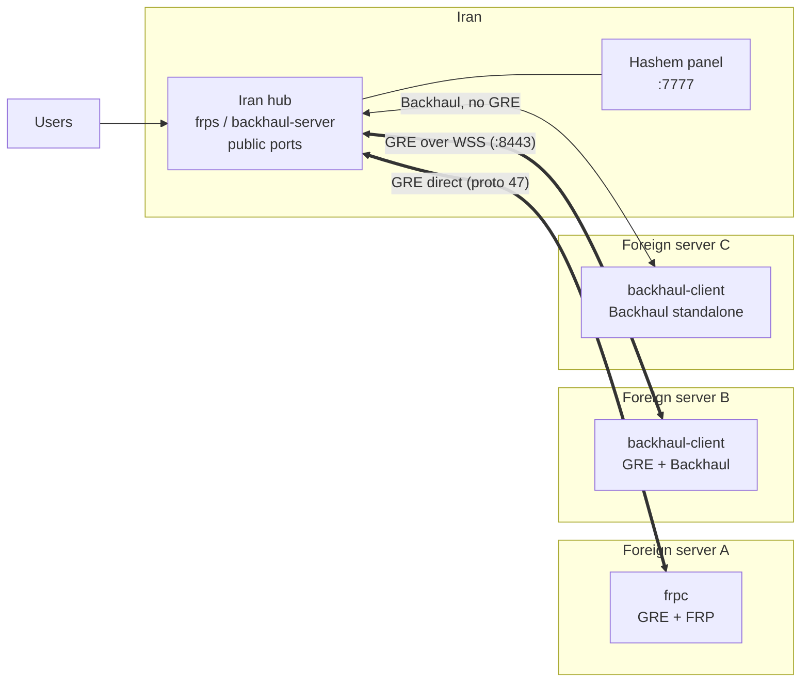

<div align="center">

# Hashem Panel 🇮🇷 ↔ 🌍

**A hub-and-spoke tunnel manager: GRE Layer-3 + FRP / Backhaul reverse relay, with a web dashboard, health model, watchdog and safe updates.**

*Keep the real servers hidden — expose foreign-server ports through the public IP of your Iran server.*

🇬🇧 English | [🇮🇷 فارسی](README.fa.md)

[](https://github.com/pdnczone/hashem-panel/releases/latest)
[](https://github.com/pdnczone/hashem-panel/actions/workflows/ci.yml)
[](https://github.com/pdnczone/hashem-panel/actions/workflows/build-panel.yml)
[](https://github.com/pdnczone/hashem-panel/actions/workflows/security.yml)
[](panel/go.mod)
[](https://github.com/pdnczone/hashem-panel/releases)
[](https://github.com/pdnczone/hashem-panel/commits/main)
[](#requirements)
[](https://www.gnu.org/licenses/agpl-3.0)

[🌐 Website](https://pdnczone.ir) · [✈️ Telegram](https://t.me/pdnczone) · [▶️ YouTube](https://youtube.com/@pdnczone) · *DNC MADE THIS*

</div>

---

## Table of contents

- [What is Hashem?](#what-is-hashem)
- [Why Hashem?](#why-hashem)
- [Features](#features)
- [Architecture](#architecture)
- [Requirements](#requirements)
- [Quick install](#quick-install)
- [Choosing an engine](#choosing-an-engine)
- [Panel tour](#panel-tour)
- [Tunnel types](#tunnel-types)
- [Health model](#health-model)
- [Automation](#automation)
- [Updates, downgrade and channels](#updates-downgrade-and-channels)
- [`hashem` CLI](#hashem-cli)
- [Troubleshooting](#troubleshooting)
- [Uninstall and your data](#uninstall-and-your-data)
- [Known limitations](#known-limitations)
- [Documentation map](#documentation-map)
- [Security notes](#security-notes)
- [Contributing](#contributing)
- [License](#license)

---

## What is Hashem?

Hashem is a tunnel manager made of two parts:

- **The installer / CLI** — `hashem.sh` (installed as `hashem`). It sets up GRE, FRP and Backhaul services with systemd.
- **The panel** — a Go backend with a single-page web UI (`gre-panel`). It runs on every server and shows the tunnel, peers, health, latency, logs, diagnostics and updates.

The model is a **hub and spokes**:

- The **Iran hub** is the server in Iran. It runs `frps` / the Backhaul server and the panel, and it owns the public ports that users connect to.
- Each **foreign server** is a spoke. It runs `frpc` / the Backhaul client and dials the hub. Traffic that arrives on the hub is relayed to the foreign server.
- Several foreign servers can be attached to one hub. The peer limit defaults to 10 and is read from the `GRE_MAX_PEERS` environment variable.

---

## Why Hashem?

Plain `frp` or Backhaul give you a relay and a config file. Hashem wraps them with the parts you would otherwise build by hand:

- **A Layer-3 link under the relay** (GRE, direct or over WSS), so the relay runs over a private inner address and can fall back to the public IP when GRE is blocked.
- **Setup bundles** — one pasted string configures the foreign side. No hand-copied tokens, ports or IPs.
- **One health model** — the same rule drives the dashboard banner, fleet cards and topology graph, and shows which leg is down.
- **Operations built in** — watchdog, webhook/Telegram alerts only on state change, 24 h history, encrypted backups, `hashem doctor`.
- **Updates you can undo** — stable/dev channels, SHA-256 verified downloads, config backup before every swap, automatic rollback after repeated crashes.
- **A hardened panel** — argon2id passwords, CSRF, optional TOTP 2FA, audit log, terminal off by default.

If you need one relay on one server pair and are happy editing TOML, plain frp or Backhaul is simpler. Hashem is for several links you want to watch and keep alive.

---

## Features

- 🚀 **One-line install** — prebuilt standalone Go binary from official GitHub releases.
- 🧩 **Three tunnel engines** — `GRE+FRP`, `GRE+Backhaul`, and `Backhaul` standalone (no GRE). See [Choosing an engine](#choosing-an-engine).
- 🛰️ **Two GRE carriers** — Direct GRE (IP protocol 47) and WSS (TLS WebSocket, port `8443` by default).
- 🔌 **FRP transports** — `tcp`, `kcp`, `quic`, `websocket`, `wss`, with payload encryption, compression and PROXY Protocol v2. See the [FRP Transports Guide](docs/FRP_TUNNELS_GUIDE.md).
- 📦 **Setup bundles** — one string carries keys, IPs, transport and ports: `hsh1_…` (FRP), `bh1_…` (Backhaul), `gh1_…` (GRE+Backhaul). Paste it on the foreign server and the form fills itself.
- 🔀 **Port management** — single ports (`443`), lists (`80,443`), ranges (`1000-1010`) and mappings (`8080=80`).
- 🩺 **One health model everywhere** — the Dashboard banner, fleet cards and topology graph use the same rules.
- ⏱️ **Latency per link and hub average** — ICMP first, kernel TCP RTT as fallback.
- 🔁 **Dial route** — foreign servers can dial the hub over the GRE inner IP or its public IP, with automatic fallback.
- 🐕 **Watchdog** — runs every minute from a systemd timer; optional Telegram alerts.
- 🔄 **Safe updates** — stable / dev channels, install any of the last 20 releases (upgrade or downgrade), SHA-256 verification, config backup, automatic rollback.
- 🎯 **Carrier benchmark** and **diagnostics** (`hashem doctor`).
- 💻 **In-browser terminal** — disabled by default, audited.
- ⚙️ **Auto Pool** — frpc `poolCount` / frps `maxPoolCount` sized automatically from pool-full errors, load and RAM (on by default).
- 🔔 **External alerts** — webhook and/or Telegram message only when a tunnel changes state (with a per-link minimum gap), plus host alerts for disk, RAM and panel TLS-certificate expiry. Set up in Settings.
- 📈 **History and metrics** — 24 h per-link latency/state/throughput graph, and an optional Prometheus `/metrics` endpoint behind a bearer token (off by default).
- 🧭 **Carrier advisor** — tells you when the active carrier keeps failing and which one to try; advice only, it never switches by itself. Also suggests free ports and SNI names.
- 🔒 **Hardened panel** — argon2id password hashes, NIST 800-63B password policy, CSRF tokens, trusted-proxy handling, audit log. See [Security notes](#security-notes).
- 📚 **Documented API** — every route and every error code is listed in [docs/API.md](docs/API.md) and [docs/ERROR_CODES.md](docs/ERROR_CODES.md), generated from the source.

---

## Architecture



Inside a GRE link, the relay (FRP or Backhaul) normally runs over the GRE inner addresses. If the GRE path is dead, the foreign side can dial the hub's public IP instead (see [Health model](#health-model) and [Automation](#automation)).

How one public connection travels:

```mermaid
sequenceDiagram
    participant User
    participant Hub as Iran hub
    participant Link as GRE / WSS / Backhaul link
    participant Srv as Foreign server
    Srv->>Hub: relay client dials the control port
    User->>Hub: connects to a public port
    Hub->>Link: forwards through the relay
    Link->>Srv: delivers to the local service
    Srv-->>User: reply travels back the same way
```

An interactive version with the layers, data path, join flow, automation and defaults is in [`docs/hashem-architecture.html`](docs/hashem-architecture.html). GitHub shows HTML as source, so [open it rendered](https://htmlpreview.github.io/?https://github.com/pdnczone/hashem-panel/blob/main/docs/hashem-architecture.html) or download the file.

---

## Requirements

- **OS:** Linux with **systemd**, `amd64` or `arm64`. Developed and tested on Ubuntu. The installer adds missing packages with `apt-get` (Debian/Ubuntu), with a `yum` fallback.
- **Access:** root (`sudo`) on both servers.
- **Tools:** `curl`, `tar`, `python3`, `iproute2` (`ip`, `ss`), `iptables`, `ping`. The installer adds any that are missing.
- **Kernel:** the `ip_gre` module for the GRE engines (`modprobe ip_gre`). Backhaul standalone needs no GRE.
- **Network** — open these between the two servers (and to users on the hub):

  | Purpose | Port / protocol |
  | --- | --- |
  | Direct GRE carrier | IP protocol **47** (not TCP/UDP) |
  | WSS carrier | TCP `8443` (default) |
  | FRP / Backhaul control | the control port you choose; the `wss` front uses `control_port+2` |
  | KCP / QUIC transports | UDP, on the ports shown in the panel |
  | Panel | TCP `7777` (moves to the next free port if busy); HTTPS `7443` once a certificate is issued |
  | Your services | the public ports you forward on the hub |

- **GitHub reachability** from the servers (releases and `raw.githubusercontent.com`) for install and updates. From inside Iran this may need a working route; the installer tries mirrors for the script itself.

---

## Quick install

Run the same one-liner on **both** servers. It is `install.sh` from this repository: it downloads `hashem.sh`, installs it as `/usr/local/bin/hashem`, and starts it.

```bash
bash <(curl -fsSL https://raw.githubusercontent.com/pdnczone/hashem-panel/main/install.sh)
```

1. **On the Iran server** — run the command and choose option `1`. Choose the engine, carrier and ports. The installer prints a **setup bundle** (for example `hsh1_…`). Copy it.
2. **On the foreign server** — run the command and choose option `2`. Paste the bundle; the tunnel and services are configured automatically.
3. **Open the panel** — the end of the install prints the secure panel URL (`http://<server-ip>:7777/<secret>`) and the first admin credentials. The password is not stored in plaintext; save it. Reset it any time with `hashem reset-password`, or CLI menu option `3 -> 2`. Print the URL again with `hashem show-panel-url`.

Adding more foreign servers: use the **Setup** tab in the panel or `hashem add-peer` / `hashem add-backhaul-peer` on the hub, then paste the new bundle on the new foreign server.

**Read it first, or pin it.** To inspect the installer before running it:

```bash
curl -fsSL https://raw.githubusercontent.com/pdnczone/hashem-panel/main/install.sh -o install.sh
less install.sh && bash install.sh
```

`install.sh` accepts `hashem.sh` only from GitHub itself, from two agreeing mirrors, or when it matches a hash you pin. Every release publishes a `checksums.txt`; pin the script like this:

```bash
HASHEM_SHA256=<sha256 of hashem.sh from the release checksums.txt> \
  bash <(curl -fsSL https://raw.githubusercontent.com/pdnczone/hashem-panel/main/install.sh)
```

The panel binary comes from the active [update channel](#updates-downgrade-and-channels). To run an exact panel version, install first, then pick the tag in the **Update** tab (or `POST /api/update {"tag":"v1.1.0"}`).

> ⚠️ **The panel speaks plain HTTP by default**, on a long random path. Before you expose it to the internet, put it behind TLS: `hashem panel-tls <domain> <email>` (needs port 80 reachable and the domain pointing at the server), or a reverse proxy — see [docs/DEPLOYMENT.md](docs/DEPLOYMENT.md).

---

## Choosing an engine

| | GRE + FRP | GRE + Backhaul | Backhaul standalone |
| --- | --- | --- | --- |
| Setup bundle | `hsh1_` | `gh1_` | `bh1_` |
| GRE interface | yes | yes | **no** |
| Relay | frp | Backhaul | Backhaul |
| Transports | tcp, kcp, quic, websocket, wss | Backhaul transports | Backhaul transports |
| Dials the hub's public IP when GRE is dead | yes | yes | n/a |
| Pick it when | you want the most features and tuning (Auto Pool, encryption, compression, PROXY v2) | you want Backhaul's relay on a private L3 link | GRE is blocked or unavailable and you only need a relay |

Start with **GRE + FRP** and the **Direct GRE** carrier. If IP protocol 47 is dropped between your servers, try the **WSS** carrier, then Backhaul standalone. The Benchmark tab probes carriers for you. More detail: [docs/ENGINES.md](docs/ENGINES.md) and the [FRP transports guide](docs/FRP_TUNNELS_GUIDE.md).

---

## Panel tour

The panel is one page with these tabs:

- **Dashboard** — a banner with one big word (Healthy / Degraded / Down) and one line per tunnel; KPIs; the Fleet Health card with hub latency, the topology graph and per-server cards.
- **Tunnel** — the main tunnel and the foreign-server peer cards: add, edit ports, restart, remove, per-tunnel PASS/FAIL checks, the dial-route card.
- **Performance** — Auto Pool, encryption / compression, and TCP multiplexing.
- **Diagnostics** — latency, jitter, MTU and speed tests; the same engine as `hashem doctor`.
- **Setup** — pairing, bundles and peers.
- **Watchdog** — monitoring, backups and alerts.
- **Benchmark** — carrier probing and the optional auto-pilot.
- **Update** — channels, install any tag, rollback state.
- **Logs, Settings, Terminal** — redacted logs with error codes; password, 2FA, idle timeout, alerts, TLS, metrics token; the audited shell (off by default).

**FRP TCP Multiplexing (`transport.tcpMux`) is OFF by default** (speed-first: tcpMux roughly halves throughput over GRE). New `frps`/`frpc` configs are written with `transport.tcpMux = false`. Turn it on only deliberately with `hashem perf tcpmux on` (or the Performance tab). The setting **must be identical on the Iran hub and every foreign spoke**; a mismatch makes `frpc` fail to log in with `connect to server error: EOF`, and `hashem status` / `hashem doctor` print a hint when they see it. Backhaul is unaffected.

---

## Tunnel types

- **GRE+FRP** (`frp`) — a GRE Layer-3 link between the two servers with FRP running over it. FRP transports: `tcp`, `kcp`, `quic`, `websocket`, `wss`. `wss` needs a TLS front: a `frps-wss*.service` unit running `gre-panel tls-proxy` on `control_port+2`. Guide: [FRP transports guide](docs/FRP_TUNNELS_GUIDE.md).
- **GRE+Backhaul** (`gre-backhaul`) — the same GRE link, with Backhaul as the relay. Bundle prefix `gh1_`.
- **Backhaul standalone** (`backhaul`) — Backhaul only, no GRE interface at all. Bundle prefix `bh1_`.
- **Carriers for the GRE layer** — **Direct GRE** (IP protocol 47) and **WSS** (TLS WebSocket, default `:8443`). The FOU carrier was removed.

---

## Health model

The same rule is used by the Dashboard banner, the fleet cards and the topology graph (`fleetHealth` in `panel/fleet.go`). Per tunnel:

- **Healthy** — (GRE up **and** FRP up **and** ICMP ping ok) **or** (FRP service up **and** the foreign client holds an ESTABLISHED TCP session on the control port — called *linked*).
- **Degraded** — exactly one leg up (GRE or FRP) and no linked session; or both up but no ping and not linked.
- **Down** — nothing up.
- **"FRP only" badge** — linked, but the GRE inner address does not answer ICMP: traffic still flows over FRP while the GRE path is blocked.

*Linked* is detected with `ss -Htn state established` on the control port (also `port+2` for the wss front and `port-2`).

The dashboard's overall status uses the same function. The main tunnel counts as one more spoke of the hub (synthetic id `0`, named `Tunnel · <ip>`).

**Latency** per link is taken in this order: (1) ICMP ping of the GRE inner address → kind `icmp`; (2) if ICMP fails, the kernel TCP RTT of the live session on the control port (from `ss -tin`) → kind `tcp`; (3) otherwise `—`. The hub summary (`/api/fleet` → `latency`) gives avg, min, max over links that have a value, the count, and how many are `icmp` vs `tcp`. History, sparkline, average, loss and uptime use the same value.

---

## Automation

- **Watchdog** — a systemd timer (`hashem-watchdog.timer`) runs `hashem watchdog tick` every minute. Control it with `hashem watchdog on|off|status|test|tick`. Telegram alerts are configured in the watchdog settings; `hashem tgsend "msg"` sends a manual message. `auto_restart` defaults to **off** (alert only).
- **Dial route** — on foreign servers, `hashem dial [status|auto|gre|public]` chooses whether `frpc` / `backhaul-client` dials the hub over the GRE inner IP or the hub public IP. `auto` uses GRE if it answers (ping or TCP to the control port), otherwise public. The watchdog switches to public automatically when GRE is dead and the client is not connected. Foreign servers show a "Route to the Iran hub" card.
- **Carrier failover** — `hashem carrier` manages and cycles carriers. Switching is manual; the advisor only suggests.
- **Backups** — `hashem backup now|restore|schedule|status` (encrypted archives in `/var/backups/hashem`).
- **Adaptive capacity** — multiplexing capacity adjusts to load and available RAM.

---

## Updates, downgrade and channels

The **Update** tab (and `hashem update` for the script + panel) uses two channels:

- **`stable`** — GitHub releases that are *not* prerelease (tags `panel-rN` and `vX.Y.Z`).
- **`dev`** — prereleases tagged `dev-rN`, built from the `dev` branch.

The channel is stored in `<configDir>/update.json` (`GET/POST /api/update/channel`). `GET /api/releases?channel=stable|dev` lists the last 20 releases of a channel. You can install **any listed tag**, newer or older — that is how you downgrade (`POST /api/update {"tag":"panel-r140"}`; without a tag, the newest of the selected channel).

Install steps: validate tag → download the panel binary and `hashem.sh` of that tag → verify SHA-256 from that tag's `checksums.txt` (fail-closed) → verify ELF / `bash -n` → back up the config dir to `<configDir>/backups/pre-<from>-<timestamp>.tar.gz` (last 5 kept; `exe.bak` and `hashem.sh.bak` kept) → swap → write `<configDir>/pending_update.json` → restart.

**Auto-rollback:** the new process counts its starts in `pending_update.json`. If it crashes 3 times before it is confirmed healthy (self health check 45 s after start), the old binary and `hashem.sh` are restored and the panel restarts.

**Branches:** `main` is stable (a push that changes `panel/**` or `hashem*.sh` builds release `panel-r<run>`); `dev` is for testing (each push builds prerelease `dev-r<run>`, never offered on stable). Promote by a manual Pull Request `dev → main`. Hotfix: branch from `main`, PR to `main`, then merge `main` back into `dev`. Release history: [CHANGELOG.md](CHANGELOG.md).

---

## `hashem` CLI

Everything works from SSH too (commands as in `hashem help`):

```bash
hashem                # first run: auto-install; afterwards shows panel credentials
hashem menu           # interactive management menu
hashem status         # tunnel health, peers, service status
hashem show-panel-url # print the panel URL again
hashem reset-password # reset / auto-generate the admin password
hashem password <p>   # set the panel password non-interactively
hashem panel-tls <domain> <email>   # HTTPS for the panel (Let's Encrypt)
hashem logs           # relay logs
hashem optimize       # BBR / MTU / sysctl tuning
hashem doctor         # latency, jitter, MTU and speed diagnostics
hashem carrier        # carrier management / failover
hashem dial status    # foreign side: route to the Iran hub
hashem watchdog status
hashem backup now     # encrypted backup (/var/backups/hashem)
hashem perf autopool status  # Auto Pool: on|off|status|tick
hashem perf tcpmux on|off    # must match on hub and spokes
hashem free-ram       # free RAM
hashem update         # update script and panel to the latest release
hashem update-channel [stable|dev]
hashem uninstall      # full wipe (see "Uninstall and your data")
```

`hashem help` prints the full list, including the non-interactive `setup-*` and `*-peer` commands.

---

## Troubleshooting

Every failure in the panel carries a stable code (`E-FRP-10`, `E-GRE-02`, …). Look the code up in [docs/ERROR_CODES.md](docs/ERROR_CODES.md), or run `hashem doctor`. The most common cases:

| Symptom | Likely cause | Fix |
| --- | --- | --- |
| `frpc` logs `connect to server error: EOF` (`E-FRP-10`) | `tcpMux` differs between hub and spoke | `hashem perf tcpmux on` or `off` on **every** server so they match (default is off) |
| `E-FRP-02` / `E-BH-01` authentication failed | token differs | re-copy the token from the Iran peer card or the bundle |
| `E-FRP-04` cannot reach server | wrong IP/port, firewall, or `frps` down | check the control port is open on the hub; run `hashem dial status` on the spoke |
| `E-GRE-02` GRE ping fails but traffic flows (**FRP only** badge) | ICMP or proto 47 filtered | expected when GRE is blocked; the dial route falls back to the public IP. Try the WSS carrier to get GRE back |
| GRE never comes up | the provider drops IP protocol 47 | open proto 47 both ways, switch the carrier to WSS, or use Backhaul standalone |
| Panel URL not reachable | port busy (the panel moves to the next free port) or a firewall | `hashem show-panel-url`; open that port |
| Lost the admin password | — | `hashem reset-password` |
| Locked out after failed logins (`E-AUTH-02`) | 5 failures → 15 min lock, doubling for repeat offenders up to 24 h | wait, or `systemctl restart gre-panel` (lockouts are kept in memory) |
| `E-UPDATE-01` / `E-UPDATE-02` | GitHub not reachable from the server | retry later or fix the route; nothing was changed |
| An update was rolled back | the new binary crashed 3 times | check `journalctl -u gre-panel`; the old version was restored automatically |
| HTTPS certificate fails (`E-TLS-05`) | port 80 closed or the domain does not point here | open port 80, fix DNS, retry |

More cases, with commands: [docs/TROUBLESHOOTING.md](docs/TROUBLESHOOTING.md).

---

## Uninstall and your data

```bash
hashem backup now      # optional: encrypted archive in /var/backups/hashem
hashem uninstall       # asks to confirm; "--force" skips the question
```

Uninstall is a **full wipe**. It removes:

- all tunnel, relay, panel and watchdog systemd units, and the GRE interfaces;
- the binaries `frps`, `frpc`, `backhaul`, `gre-panel`, `grepanel`, and the `hashem` command itself;
- `/etc/frp`, `/etc/backhaul`, `/etc/gre-panel` (panel config, history and the **backup key**) and `/usr/local/gre-panel`;
- Hashem logs, locks, cron entries, its iptables rules and its sysctl tuning.

It does **not** remove `/var/backups/hashem`. But those archives are encrypted with `/etc/gre-panel/backup.key`, which the wipe deletes. **Copy `backup.key` somewhere safe before uninstalling** if you want to restore later.

---

## Known limitations

- **GRE can be blocked.** Some providers drop IP protocol 47. The WSS carrier and Backhaul standalone exist for that case, but no carrier is guaranteed to pass every network.
- **The panel is HTTP by default.** Use `hashem panel-tls` or a reverse proxy for anything public.
- **One admin account** per panel; there are no roles.
- **Linux + systemd only**, `amd64` and `arm64` builds.
- **Peer limit** of 10 per hub by default (`GRE_MAX_PEERS`).
- **Automatic actions are conservative on purpose:** watchdog `auto_restart` is off and the carrier is never switched automatically.
- **Docs language:** the README and the FRP guide exist in Persian; the other guides are English.

Ideas and bug reports are welcome — see [Contributing](#contributing).

---

## Documentation map

- **Start here** — [Quick install](#quick-install) · [Choosing an engine](docs/ENGINES.md) · [Troubleshooting](docs/TROUBLESHOOTING.md)
- **Guides** — [FRP transports guide](docs/FRP_TUNNELS_GUIDE.md) (Persian + English) · [Secure deployment](docs/DEPLOYMENT.md)
- **Reference** — [HTTP API](docs/API.md) · [Error codes](docs/ERROR_CODES.md) · [CHANGELOG](CHANGELOG.md) · [Architecture (interactive)](docs/hashem-architecture.html)
- **Project** — [CONTRIBUTING](CONTRIBUTING.md) · [Development guide](docs/dev/DEVELOPMENT.md) · [Code of conduct](CODE_OF_CONDUCT.md) · [SECURITY](SECURITY.md)
- **Audits and plans** — [docs/audit/](docs/audit/) · [r24 improvement plan](docs/PLAN_IMPROVEMENTS_R24.md)

---

## Security notes

- **Policy and disclosure:** [SECURITY.md](SECURITY.md).
- **Production deployment** (Nginx / Caddy, TLS, firewall, `TRUSTED_PROXY_IPS`): [docs/DEPLOYMENT.md](docs/DEPLOYMENT.md).
- Passwords are stored only as salted **argon2id** hashes in `/etc/gre-panel/panel.json` (older unsalted SHA-256 hashes are upgraded on the next login). The policy requires 12+ characters with upper, lower, number and symbol.
- State-changing requests need a session-bound HMAC-SHA256 `X-CSRF-Token`; `X-Forwarded-For` is trusted only from `TRUSTED_PROXY_IPS`.
- Updates are pinned to official GitHub domains and verified with SHA-256 from `checksums.txt`; the installer script is checked with `bash -n`.
- The in-browser terminal is **disabled by default** and audited (10-minute idle and 30-minute absolute limits).
- Security events and **every state-changing API call** (method, path, status; never the body) are written to `/etc/gre-panel/security-audit.log` (rotated at 2 MiB, newest entries via `GET /api/audit`).
- Login lockout escalates for repeat offenders (15 min, doubling up to 24 h).
- Optional **TOTP two-factor login** (Settings → Two-factor authentication) with 8 single-use recovery codes; off by default. Recovery if you lose the device: set `GRE_PANEL_PASSWORD` and remove `totp_enabled` from `panel.json`.
- Optional **idle session timeout** (Settings), driven by real clicks/keys, not background refresh.
- The terminal asks for your password (and 2FA code) every time it opens, uses a single-use 60 s ticket bound to your session and IP, and can be limited to an **IP allowlist**.
- `install.sh` only accepts `hashem.sh` from GitHub itself, from two agreeing mirrors, or matching a pinned `HASHEM_SHA256`; otherwise it stops.
- Logs shown in the panel mask tokens and passwords (Backhaul prints rejected tokens verbatim).
- Backups include every panel config and Backhaul unit; restore refuses archives that reach outside the config directories and first saves a safety copy of the current state.

---

## Contributing

Issues and Pull Requests are welcome. Read [CONTRIBUTING.md](CONTRIBUTING.md) first: branch from `dev`, run the tests, regenerate the API docs, open a PR. Use the issue forms for bugs and ideas; report vulnerabilities privately as described in [SECURITY.md](SECURITY.md).

## License

Licensed under the **GNU Affero General Public License v3.0 (AGPL-3.0)**. If you modify this software and run it as a network service, you must make your modifications available under the same license. See [LICENSE](LICENSE).

## Community

- 🌐 [pdnczone.ir](https://pdnczone.ir) · ✈️ [@pdnczone](https://t.me/pdnczone) · ▶️ [@pdnczone](https://youtube.com/@pdnczone)
